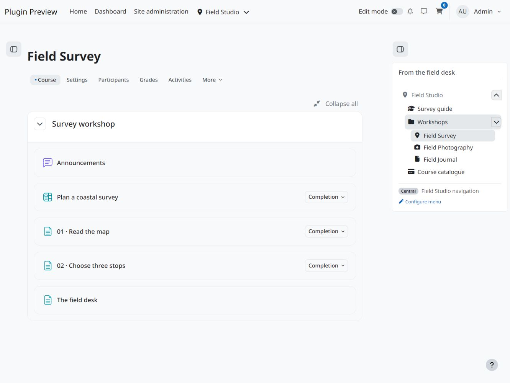

  

# Menu Builder Block

Display a saved Menu Builder menu in a Moodle block. Use the same menu in several courses or on the dashboard and edit it once in Menu Builder. Each block can have its own title, layout and spacing.

## Screenshots

View screenshots

## Requirements and installation

- Moodle 4.5 through 5.3.
- A saved menu in [Menu Builder](https://github.com/108design/moodle-local_menubuilder-le).

Download the signed installation ZIP from the [latest release](https://github.com/108design/moodle-block_frontpage_menu/releases/latest). Upload it under **Site administration > Plugins > Install plugins**. For a manual installation, place the `frontpage_menu` directory in `blocks/` and complete the upgrade under **Site administration > Notifications**. [Moodle installation guide](https://docs.moodle.org/503/en/Installing_plugins)

## Add a menu block

1. Open a page where you can add blocks and turn editing on.
2. Choose **Add a block**, then **Menu Builder Block**.
3. Open the block configuration and select a saved menu under **Menu source**. Enter a block title if you want a different heading.
4. Use **Compact vertical menu** for a side column or **Wide horizontal menu** for a wider region. Set **Density** to Compact, Normal or Spacious, then save.

Available block regions depend on the theme and page. Menu Builder controls which entries each viewer sees. Moodle checks access when the viewer follows a link.

## Maintain a shared menu

Edit the menu in Menu Builder to update every block that uses it. Change the block configuration to adjust the presentation on just one page. If a block is empty, check its selected menu and preview the page as a user who should see the entries.

To place a menu inside the body of a Moodle activity or page, use the [Menu Builder Shortcode Filter](https://github.com/108design/moodle-filter_frontpage_menu).

## Support

[Report an issue](https://github.com/108design/moodle-block_frontpage_menu/issues) with your Moodle version, theme, plugin version and steps to reproduce the problem.

## License

This release is available free of charge under the 108design Software License.

See [LICENSE.md](LICENSE.md) for the full terms.
